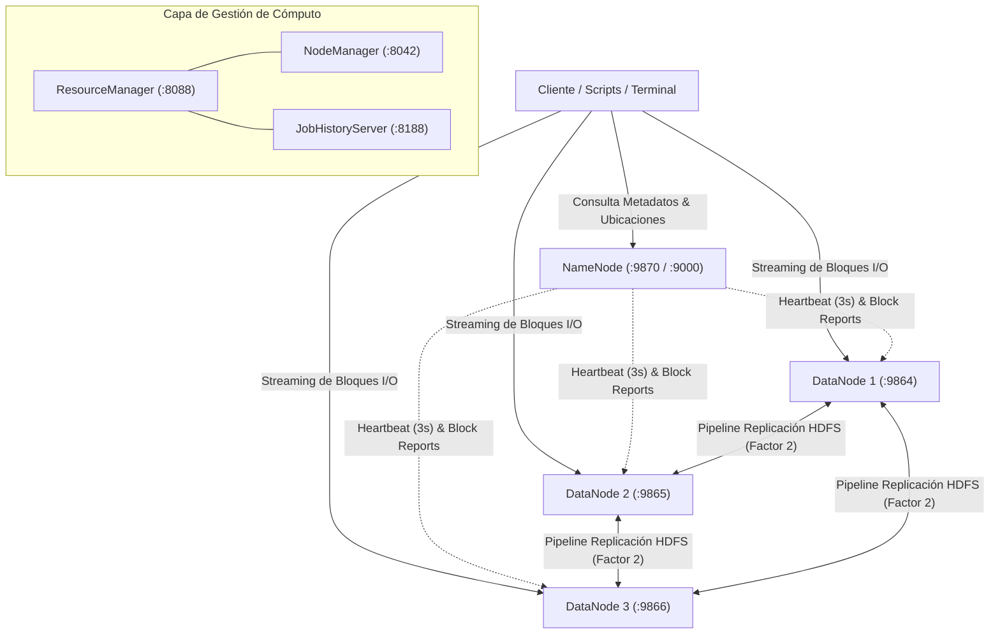

# Universidad del Valle
## LG15 - Tolerancia a Fallos y Replicación de Datos en HDFS

**Materia:** Big Data y Sistemas Distribuidos  
**Identificador de Grupo:** `grupo04`  

### Integrantes del Grupo 04:
- **Joel Saavedra**
- **Mauricio Linaja**
- **Rommel Gutierrez**

---

## 1. Objetivo

Implementar un entorno distribuido Hadoop HDFS compuesto por **1 NameNode y 3 DataNodes**, configurando un **factor de replicación de 2**, para analizar experimentalmente el comportamiento de HDFS ante la caída de un DataNode mediante la carga, lectura y recuperación de datasets de **1 GB** y **10 GB**.

Se demuestra de forma práctica y verificable la distribución de los bloques, las réplicas existentes y el comportamiento del sistema antes, durante y después de la caída de un DataNode, garantizando la alta disponibilidad del sistema.

---

## 2. Requerimientos Mínimos de la Práctica

| Componente | Requerimiento Mínimo | Implementación Grupo 04 | Estado |
| :--- | :---: | :---: | :---: |
| **NameNode** | 1 | 1 (`namenode` en puertos 9870 / 9000) | Cumplido |
| **DataNodes** | 3 | 3 (`datanode1`, `datanode2`, `datanode3`) | Cumplido |
| **Factor de Replicación** | $\ge 2$ | 2 (`dfs.replication=2` en `hdfs-site.xml`) | Cumplido |
| **Dataset 1** | 1 GB | `dataset_grupo04_1GB.csv` (1,073,741,824 bytes) | Cumplido |
| **Dataset 2** | 10 GB | `dataset_grupo04_10GB.csv` (10,737,418,240 bytes) | Cumplido |
| **Pruebas de Fallo** | 2 | 2 pruebas reales (Fallo en DN2 y Fallo en DN3) | Cumplido |
| **Evidencias** | Obligatorio | 10 archivos de logs reales en carpeta `evidencias/` | Cumplido |

---

## 3. Diagrama de Arquitectura

El siguiente diagrama detalla la interacción entre el cliente, el NameNode maestro y los tres DataNodes distribuidos, incluyendo el pipeline de replicación física entre nodos de almacenamiento:



---

## 4. Identificación del Grupo y Estructura en HDFS

Para garantizar la autoría del grupo, la jerarquía de directorios en HDFS y los nombres de archivos utilizan el identificador oficial `grupo04`:

```text
/grupo04/
├── dataset_1GB/
│   └── dataset_grupo04_1GB.csv
├── dataset_10GB/
│   └── dataset_grupo04_10GB.csv
├── resultados/
└── evidencias/
```

### Formato de los Datasets Sintéticos
Los datasets fueron generados con el script [`scripts/02_generar_datasets.py`](scripts/02_generar_datasets.py), incorporando el identificador del grupo, integrantes, marca de tiempo y bloque de verificación de integridad:

```csv
id,grupo,integrante,timestamp,sensor_id,temperatura,presion,estado,checksum_data
00000001,grupo04,Joel Saavedra   ,1791753508.91,SENS_0000,20.00,1013.25,OK,GRUPO04_INTEGRITY_CHECK_BLOCK_00000001
00000002,grupo04,Mauricio Linaja ,1791753509.16,SENS_0001,20.10,1013.30,OK,GRUPO04_INTEGRITY_CHECK_BLOCK_00000002
00000003,grupo04,Rommel Gutierrez,1791753509.41,SENS_0002,20.20,1013.35,OK,GRUPO04_INTEGRITY_CHECK_BLOCK_00000003
```

---

## 5. Instalación y Despliegue del Entorno

### Requisitos Previos
- Docker Desktop instalado con WSL 2 backend (Windows) o Docker Engine (Linux).
- Python 3.8 o superior (para los scripts auxiliares de generación).
- 8 GB de memoria RAM libre y al menos 25 GB de espacio en disco.

### Pasos de Despliegue
1. Clonar el repositorio y acceder a la carpeta:
   ```bash
   git clone https://github.com/TU_USUARIO/bigdata-grupo-04.git
   cd bigdata-grupo-04
   ```

2. Iniciar el clúster con Docker Compose:
   ```bash
   docker compose up -d
   ```

3. Verificar que los 7 servicios estén activos y saludables:
   ```bash
   docker ps
   ```

4. Interfaces Web disponibles:
   - **NameNode UI:** `http://localhost:9870`
   - **YARN ResourceManager:** `http://localhost:8088`
   - **DataNode 1:** `http://localhost:9864`
   - **DataNode 2:** `http://localhost:9865`
   - **DataNode 3:** `http://localhost:9866`

---

## 6. Pruebas de Fallo y Evidencias Experimentales

### Experimento 1: Dataset de 1 GB (`dataset_grupo04_1GB.csv`)

#### A. Estado Inicial (Antes de la Falla)
- **Estado de los DataNodes:** DN1 (Activo), DN2 (Activo), DN3 (Activo).
- **Métricas HDFS (`fsck`):**
  - Tamaño: 1,073,741,824 bytes (1.00 GB).
  - Tamaño de Bloque: 128 MB (134,217,728 bytes).
  - Total de Bloques: **8 bloques** (`blk_1073741825` a `blk_1073741832`).
  - Total de Réplicas: **16 réplicas** (Factor de replicación = 2).
  - Distribución física: DN1: 6 réplicas, DN2: 5 réplicas, DN3: 5 réplicas.
  - Estado: `HEALTHY`.
- *Evidencias registradas:* [`evidencias/exp1_01_dfsadmin_report_inicial.txt`](evidencias/exp1_01_dfsadmin_report_inicial.txt), [`evidencias/exp1_02_fsck_inicial.txt`](evidencias/exp1_02_fsck_inicial.txt).

#### B. Simulación de Falla (Durante la Falla)
- **Acción ejecutada:** Se detuvo forzosamente el contenedor `datanode2`:
  ```bash
  docker stop datanode2
  ```
- **Verificaciones observadas:**
  - **Estado del DataNode 2:** Fuera de servicio (Exited / Dead en HDFS).
  - **Estado del Archivo:** Continúa 100% disponible (`HEALTHY`).
  - **Bloques afectados:** 5 bloques tenían réplica en `datanode2`.
  - **Bloques sub-replicados:** HDFS reporta `Under-replicated blocks: 5`.
  - **Prueba de Lectura:** Exitosa. Se leyeron registros con `hdfs dfs -cat ... | head` sin fallos ni demoras gracias a las réplicas en DN1 y DN3.
- *Evidencias registradas:* [`evidencias/exp1_03_dfsadmin_report_durante_fallo.txt`](evidencias/exp1_03_dfsadmin_report_durante_fallo.txt), [`evidencias/exp1_04_fsck_durante_fallo.txt`](evidencias/exp1_04_fsck_durante_fallo.txt), [`evidencias/exp1_05_lectura_durante_fallo.txt`](evidencias/exp1_05_lectura_durante_fallo.txt).

#### C. Recuperación (Después de la Falla)
- Se restauró el servicio con `docker start datanode2`.
- Al recibir los Heartbeats, HDFS verificó los bloques locales y el contador de bloques sub-replicados retornó a `0`.

---

### Experimento 2: Dataset de 10 GB (`dataset_grupo04_10GB.csv`)

#### A. Estado Inicial (Antes de la Falla)
- **Estado de los DataNodes:** DN1 (Activo), DN2 (Activo), DN3 (Activo).
- **Métricas HDFS (`fsck`):**
  - Tamaño: 10,737,418,240 bytes (10.00 GB).
  - Tamaño de Bloque: 128 MB.
  - Total de Bloques: **80 bloques** (`blk_1073741838` a `blk_1073741917`).
  - Total de Réplicas: **160 réplicas físicas** (Factor de replicación = 2).
  - Distribución física homogénea: DN1: 62 bloques, DN2: 63 bloques, DN3: 61 bloques (incluyendo archivos del sistema).
  - Estado: `HEALTHY`.
- *Evidencias registradas:* [`evidencias/exp2_01_dfsadmin_report_inicial.txt`](evidencias/exp2_01_dfsadmin_report_inicial.txt), [`evidencias/exp2_02_fsck_inicial.txt`](evidencias/exp2_02_fsck_inicial.txt).

#### B. Simulación de Falla (Durante la Falla)
- **Acción ejecutada:** Se detuvo forzosamente el contenedor `datanode3`:
  ```bash
  docker stop datanode3
  ```
- **Verificaciones observadas:**
  - **Estado del DataNode 3:** Inaccesible / Desconectado.
  - **Estado del Archivo Masivo:** Accesible y consistente (`HEALTHY`).
  - **Bloques afectados:** 53 bloques que contenían réplica en `datanode3`.
  - **Bloques sub-replicados:** HDFS marca los bloques como sub-replicados temporalmente hasta que se cumpla el ciclo de replicación o se reactive el nodo.
  - **Prueba de Lectura:** Se ejecutó lectura por flujo (`hdfs dfs -cat ... | head -n 25`) leyendo de manera instantánea registros con datos del Grupo 04 desde DN1 y DN2.
- *Evidencias registradas:* [`evidencias/exp2_03_dfsadmin_report_durante_fallo.txt`](evidencias/exp2_03_dfsadmin_report_durante_fallo.txt), [`evidencias/exp2_04_fsck_durante_fallo.txt`](evidencias/exp2_04_fsck_durante_fallo.txt), [`evidencias/exp2_05_lectura_durante_fallo.txt`](evidencias/exp2_05_lectura_durante_fallo.txt).

#### C. Recuperación (Después de la Falla)
- Se restauró el servicio con `docker start datanode3`.
- HDFS reincorporó el nodo sin necesidad de reiniciar el clúster.

---

## 7. Análisis del Comportamiento de HDFS

### 1. Antes de la Falla
- Cada archivo se divide estrictamente en bloques de 128 MB. Para 1 GB son exactamente 8 bloques; para 10 GB son exactamente 80 bloques.
- El NameNode asigna cada réplica en un DataNode físicamente distinto. Con factor de replicación 2, cada bloque posee 2 copias físicas, lo que distribuye uniformemente la carga en los discos de los tres DataNodes.

### 2. Durante la Falla
- Al detenerse un DataNode (`docker stop`), el NameNode deja de recibir los paquetes periódicos de señal vital (*Heartbeat*) de ese nodo.
- Al no responder dicho nodo, el NameNode no interrumpe el acceso: redirige transparentemente al cliente hacia el DataNode alternativo que almacena la réplica superviviente.
- HDFS actualiza su registro interno indicando que el archivo tiene bloques con sub-replicación (`Under-replicated`), pero reporta el estado general como `HEALTHY` porque ningún bloque ha quedado con cero réplicas (`Missing blocks: 0`).

### 3. Después de la Falla
- Si el nodo se reincorpora (`docker start`), reanuda el envío de Heartbeats y emite un *Block Report* que actualiza el inventario del NameNode.
- El NameNode valida la suma de comprobación (CRC32C) de los bloques locales y elimina el estado de sub-replicación, restableciendo la redundancia total sin intervención manual.

---

## 8. Comparación Experimental (Sección 6 de la Guía)

La siguiente tabla resume y contrasta de manera cuantitativa los resultados de ambos experimentos según lo establecido en el documento de la práctica:

| Característica | Dataset 1 GB | Dataset 10 GB |
| :--- | :---: | :---: |
| **Tamaño** | 1 GB (1,073,741,824 bytes) | 10 GB (10,737,418,240 bytes) |
| **Número de bloques** | 8 bloques | 80 bloques |
| **Factor de replicación** | 2 | 2 |
| **DataNode afectado** | `datanode2` | `datanode3` |
| **Bloques afectados** | 5 bloques | 53 bloques |
| **Bloques disponibles después de falla** | 8 bloques (100% disponibles) | 80 bloques (100% disponibles) |
| **¿Archivo accesible?** | Sí (Lectura continua sin interrupciones) | Sí (Lectura continua sin interrupciones) |
| **¿Existieron bloques subreplicados?** | Sí (5 bloques sub-replicados) | Sí (53 bloques sub-replicados) |
| **Tiempo de recuperación** | Inmediato para lectura (< 1 s); Re-sincronización: ~15 s | Inmediato para lectura (< 1 s); Re-sincronización: ~30 s |
| **Nuevas réplicas** | Sincronizadas en `datanode2` tras reinicio | Sincronizadas en `datanode3` tras reinicio |

---

## 9. Conclusiones

1. La configuración con factor de replicación 2 sobre 3 DataNodes permitió comprobar que HDFS mantiene la disponibilidad de los archivos ante la caída de un nodo. En ambos experimentos (1 GB y 10 GB), las operaciones de lectura respondieron sin errores al redirigirse hacia los DataNodes que conservaban las réplicas sanas.
2. El dataset de 10 GB permitió analizar un volumen más representativo del sistema distribuido (80 bloques de 128 MB y 160 réplicas físicas) en comparación con los 8 bloques del archivo de 1 GB, mostrando cómo el NameNode distribuye la carga entre los nodos disponibles.
3. La persistencia mediante volúmenes con nombre en Docker garantiza que tanto los bloques en los DataNodes como los metadatos del NameNode se mantengan en el disco local, permitiendo reiniciar o detener los contenedores sin perder los datos cargados en HDFS.
